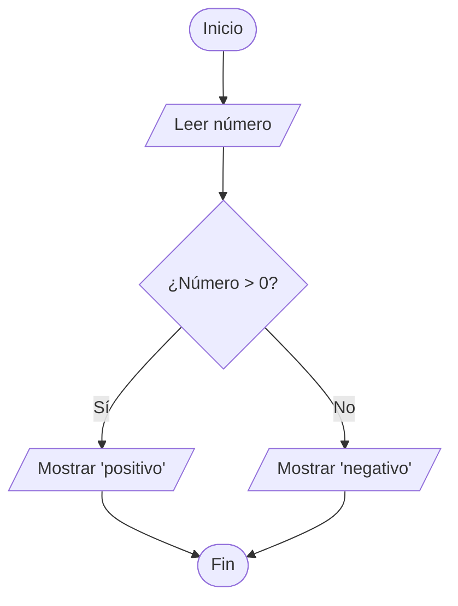

## 🦊 kEnAi MSG — Minimalist Site Generator

Un generador de sitios web minimalista y agnóstico hecho con **Vanilla PHP**, **sin dependencias de terceros**. Acepta plantillas en formatos **HTML**, **Markdown** y **PHP**, con metadatos en **YAML** y un parser de Markdown propio (**MarKenai**) con soporte estilo GitHub, diagramas **Mermaid** y _safe mode_.

---

## 💡 Una sola carpeta, sin paso de _build_

A diferencia de los generadores estáticos tradicionales (Eleventy, Astro, Jekyll, Hugo…), que dividen el proyecto en **dos carpetas** —una de **origen** y otra de **compilado**— y te obligan a un **paso de _build_**, en kEnAi MSG **todo se gestiona en una sola carpeta**: el HTML se **renderiza al vuelo en cada petición**.

```text
SSG tradicional                  kEnAi MSG
─────────────────────────        ─────────────────────────
src/    → (build) → dist/        content/  → (se sirve tal cual)
escribes           publicas      escribes y publicas: es lo mismo
```

El contenido **es** el sitio: sin compilación, sin carpeta duplicada y sin desincronización entre origen y salida. Editas y listo. De ahí el nombre: **M**inimalist **S**ite **G**enerator (no _Static_).

---

## 📋 Características

- ✅ **Múltiples formatos de contenido**: HTML, Markdown (.md) y PHP
- ✅ **FrontMatter YAML**: Metadatos en cada archivo de contenido
- ✅ **Parser de Markdown propio (MarKenai)**: GFM, sin librerías externas
- ✅ **Diagramas Mermaid**: bloques de código `mermaid` renderizados en el navegador
- ✅ **IDs automáticos en encabezados**: navegación por anclas (estilo GitHub)
- ✅ **Layouts dinámicos**: Plantillas separadas para páginas y posts
- ✅ **Sistema de etiquetas**: Organización de contenido por categorías
- ✅ **Búsqueda integrada**: Búsqueda de texto completo en todo el sitio
- ✅ **URLs amigables**: Rutas limpias y semánticas
- ✅ **SEO**: canonical, Open Graph y Twitter Cards automáticos
- ✅ **Sitemap y Feed RSS dinámicos**: más `robots.txt`, sin paso de build
- ✅ **Borradores y publicación programada**: `draft` y fecha futura
- ✅ **Paginación del blog**: rutas `/blog/page/N`
- ✅ **Resaltado de sintaxis**: Prism.js integrado para bloques de código
- ✅ **Seguridad reforzada**: anti _path traversal_, CSP y cabeceras, _safe mode_, saneo de URLs
- ✅ **Diseño responsive**: Mobile-first con CSS moderno
- ✅ **Sin dependencias externas**: Solo PHP vanilla

---

## 🚀 Instalación

### Requisitos

- **PHP 8.0 o superior**
- Servidor web (Apache, Nginx, o el servidor embebido de PHP)

### Pasos

1. **Clona o descarga el proyecto**:

   ```bash
   git clone https://github.com/jonmircha/kenai-msg.git
   cd kenai-msg
   ```

2. **Configura tu sitio**:
   Edita el archivo `app/config/site.yml` con los datos de tu proyecto:

   ```yaml
   title: Mi Sitio Web
   description: Descripción de mi sitio
   author: Tu Nombre
   # url: https://misitio.com   # opcional — ver "URL del sitio y SEO"
   ```

3. **Inicia el servidor de desarrollo** (usa el `router.php` incluido):

   ```bash
   php -S localhost:8084 router.php
   ```

   Para ver errores durante el desarrollo, antepón `APP_DEBUG=1`:

   ```bash
   APP_DEBUG=1 php -S localhost:8084 router.php
   ```

4. **Abre tu navegador**:
   Visita `http://localhost:8084`

---

## 📁 Estructura del Proyecto

```
kenai-msg/
├── app/                        # Núcleo de la aplicación
│   ├── cache/                  # Caché de plantillas .php (autogenerada)
│   ├── config/
│   │   └── site.yml            # Configuración principal
│   ├── core/                   # Clases y funciones del sistema
│   │   ├── ContentFile.php     # Lee y separa frontmatter/contenido
│   │   ├── MarKenai.php        # Parser de Markdown propio (GFM + Mermaid)
│   │   ├── YamlParser.php      # Parser de YAML (frontmatter)
│   │   └── helpers.php         # Funciones helper
│   ├── layouts/
│   │   ├── page.php            # Layout para páginas
│   │   └── post.php            # Layout para artículos
│   ├── partials/
│   │   ├── header.php
│   │   ├── footer.php
│   │   ├── metatags.php
│   │   └── search.php
│   └── .htaccess               # Deniega acceso HTTP directo a app/
├── assets/                     # Recursos estáticos (públicos)
│   ├── css/
│   │   └── prism.css
│   ├── js/
│   │   ├── prism.js            # Resaltado de sintaxis (Prism 1.30.0)
│   │   ├── mermaid-init.js     # Inicializador de Mermaid (auto-hospedado)
│   │   └── mermaid.min.js      # Runtime de Mermaid (colócalo tú)
│   ├── main.js
│   └── styles.css
├── content/                    # Contenido del sitio
│   ├── blog/                   # Artículos del blog
│   ├── index.html              # Página de inicio
│   ├── acerca.md               # Esta documentación
│   ├── blog.php                # Listado de blog
│   ├── categorias.php          # Sistema de categorías
│   ├── busqueda.php            # Página de búsqueda
│   ├── 404.md                  # Página de error
│   └── .htaccess               # Deniega acceso HTTP directo a content/
├── img/
├── .gitignore
├── .htaccess                   # Front controller + bloqueo de directorios
├── index.php                   # Punto de entrada (front controller)
└── router.php                  # Router para el servidor de desarrollo
```

---

## ✍️ Creando Contenido

### Formatos Soportados

#### 1. **Markdown (.md)**

```markdown
---
layout: page
title: Mi Página
description: Descripción de la página
tags: ["paginas"]
date: 2025-12-03
---

# Título

Este es el contenido en **Markdown**.
```

#### 2. **HTML (.html)**

```html
---
layout: page
title: Mi Página HTML
description: Página en HTML puro
tags: ["paginas"]
date: 2025-12-03
---

<h1>{{title}}</h1>
<p>{{description}}</p>
```

En `.md` y `.html` puedes interpolar variables con `{{ variable }}`, `{{ site.title }}`, `{{ tags[0] }}`, etc. En `.php` se usa PHP nativo, no `{{ }}`.

#### 3. **PHP (.php)**

```php
---
layout: page
title: Mi Página Dinámica
description: Página con lógica PHP
tags: ["paginas"]
date: 2025-12-03
---

<h2>Artículos Recientes</h2>
<ul>
  <?php foreach (getCollection('blog', true) as $post): ?>
    <li>
      <a href="<?= htmlspecialchars($post['url']) ?>">
        <?= htmlspecialchars($post['data']['title']) ?>
      </a>
    </li>
  <?php endforeach; ?>
</ul>
```

#### Variables y funciones disponibles en plantillas `.php`

Dentro de un archivo de contenido `.php` tienes en _scope_:

- **`$page`**: datos de la página actual, con las claves `meta` (el FrontMatter), `filepath`, `uri`, `layout`, `base` y `site`. _(Ojo: `$page['content']` solo existe dentro de los layouts, no en la plantilla.)_
- **`$site`**: la configuración de `site.yml` (`title`, `description`, `url`, `author`) más `base` (el prefijo de ruta).
- **Todas las funciones helper** de `app/core/helpers.php` (`getCollection()`, `getAllTags()`, `searchContent()`, `partial()`, …).

Las rutas amigables que reciben parámetros los exponen vía `$_GET`:

- `/categorias/<tag>` → `$_GET['tag']`
- `/busqueda?q=<término>` → `$_GET['q']`

> Escapa **siempre** la salida con `htmlspecialchars()`, y filtra/usa la lógica con el valor crudo (no con el ya escapado).

### Metadatos (FrontMatter)

Todos los archivos de contenido deben incluir un bloque YAML al inicio:

```yaml
layout: page # Layout a usar (page o post)
title: Título # Título de la página
description: Desc # Descripción (meta tag)
tags: ["tag1", "tag2"] # Etiquetas/categorías
date: 2025-12-03 # Fecha (YYYY-MM-DD)
```

#### Campos opcionales

| Campo     | Tipo   | Efecto                                                                 |
| --------- | ------ | ---------------------------------------------------------------------- |
| `image`   | string | Imagen social (`og:image` / `twitter:image`). Relativa o URL completa. |
| `draft`   | bool   | `true` → oculta del listado/búsqueda/sitemap (borrador).               |
| `sitemap` | bool   | `false` → excluye la página del `sitemap.xml` (p. ej. 404, búsqueda).  |

---

## 📝 Markdown con MarKenai

Los archivos `.md` se procesan con **MarKenai**, el parser de Markdown propio del proyecto (`app/core/MarKenai.php`), **sin dependencias externas**. Soporta el dialecto _GitHub Flavored Markdown_ de uso común:

- Encabezados ATX y Setext con **IDs únicos** automáticos
- Énfasis: **negrita**, _cursiva_, **_ambas_**, ~~tachado~~ y `código`
- Bloques de código cercados con lenguaje y resaltado Prism
- **Diagramas Mermaid**
- Listas ordenadas, desordenadas y **anidadas**, con _task lists_:
  - [x] Tarea completada
  - [ ] Tarea pendiente
- **Tablas** con alineación
- Citas, reglas horizontales, enlaces e imágenes
- Autolinks (URLs y emails) y emojis (`:rocket:` → 🚀)

### Tabla de ejemplo

| Formato  | Extensión |         Procesado por |
| :------- | :-------: | --------------------: |
| Markdown |   `.md`   |              MarKenai |
| HTML     |  `.html`  | Interpolación `{{ }}` |
| PHP      |  `.php`   |         Plantilla PHP |

### Safe mode

Por defecto el contenido se considera de **autor de confianza** y se permite HTML crudo dentro del Markdown. Para escapar todo el HTML, activa el _safe mode_ en `index.php`:

```php
$parser = new MarKenai();
$parser->setSafeMode(true); // escapa el HTML crudo del Markdown
```

> Independientemente del _safe mode_, MarKenai **siempre** sanea las URLs de enlaces e imágenes y bloquea esquemas peligrosos como `javascript:` o `data:`.

---

## 📊 Diagramas Mermaid

Escribe un bloque de código con el lenguaje `mermaid`:

````markdown

````

Y se renderiza así (requiere `assets/js/mermaid.min.js`):



El render ocurre en el navegador mediante el runtime de Mermaid, cargado de forma **auto-hospedada** (sin CDN). Para activarlo, descarga `dist/mermaid.min.js` desde [github.com/mermaid-js/mermaid](https://github.com/mermaid-js/mermaid) y colócalo en `assets/js/mermaid.min.js`.

**Carga diferida en dos niveles** — las páginas sin diagramas no descargan nada de Mermaid:

1. **En el servidor**: el layout solo incluye `mermaid-init.js` si la página renderizó un diagrama real (`<pre class="mermaid">`).
2. **En el navegador**: `mermaid-init.js` (≈1.6 KB) solo descarga el pesado `mermaid.min.js` (≈3.3 MB) cuando hay diagramas en el DOM.

Si `mermaid.min.js` no está, los diagramas se muestran como texto (degradación elegante).

---

## 🎨 Layouts

### `page.php` — Para Páginas Generales

Usado para páginas estáticas como Inicio, Acerca de, Contacto, etc.

### `post.php` — Para Artículos de Blog

Incluye metadatos adicionales (fecha, etiquetas) y navegación específica para blog.

Para especificar el layout, usa el campo `layout` en el FrontMatter:

```yaml
layout: post # Usa el layout de artículo
```

---

## 🔍 Funciones Helper

El archivo `app/core/helpers.php` incluye funciones útiles. Las que devuelven contenido lo hacen como un array de **items**, donde cada item tiene esta forma:

```php
[
  'url'      => 'https://misitio.com/blog/mi-post', // URL del contenido
  'data'     => [ /* FrontMatter: title, date, tags, ... */ ],
  'filepath' => 'content/blog/mi-post.md',
]
```

Por eso accedes a los metadatos con `$post['data']['title']`, `$post['data']['date']`, etc.

### `getAllPosts()`

Devuelve todos los posts de `content/blog/` (array de items).

### `getAllSiteContent()`

Devuelve todo el contenido del sitio, recursivo (array de items). Memoizado por petición.

### `getAllTags()`

Devuelve un mapa `['etiqueta' => conteo]`, ordenado alfabéticamente.

```php
foreach (getAllTags() as $tag => $count) {
  echo htmlspecialchars($tag) . " ($count)";
}
```

### `getCollection(string $tag, bool $reverse = false)`

Filtra el contenido por etiqueta (array de items), ordenado por fecha (`$reverse = true` para más reciente primero).

```php
$peliculas = getCollection('peliculas');  // ascendente
$recientes = getCollection('blog', true); // descendente (más reciente primero)
```

### `searchContent(string $query)`

Busca un término en todo el sitio. Devuelve un array de resultados con las claves `title`, `description`, `url`, `excerpt` y `filepath` (el término se limita a 100 caracteres).

### `paginate(array $items, int $page = 1, int $perPage = 5)`

Pagina un array de items. Devuelve el slice de la página actual más metadatos (`page`, `totalPages`, `hasPrev`, `hasNext`, `prevPage`, `nextPage`, `total`, `perPage`).

```php
$pag = paginate(getCollection('blog', true), $pageNum, 5);
foreach ($pag['items'] as $post) { /* ... */ }
```

### `isPublished(array $meta)`

Indica si un contenido debe aparecer en listados públicos: `false` si es borrador (`draft: true`) o tiene fecha futura. En desarrollo (`APP_DEBUG`) siempre `true`.

### `partial(string $name, array $vars = [])`

Incluye un partial desde `app/partials/`.

```php
partial('header');
```

---

## 🏷️ Sistema de Categorías

Las categorías se definen mediante el campo `tags` en el FrontMatter:

```yaml
tags: ["blog", "peliculas", "series"]
```

Accede a las categorías en:

- **Lista de categorías**: `/categorias`
- **Categoría específica**: `/categorias/peliculas`

---

## 🔎 Búsqueda

El sistema incluye búsqueda de texto completo. Accede a `/busqueda?q=termino` o usa el formulario en el header. El término se limita a 100 caracteres.

---

## 🗓️ Borradores y publicación programada

Dos campos del FrontMatter controlan la visibilidad en **listados, búsqueda y sitemap**:

- **`draft: true`** → borrador: no aparece en listados.
- **`date` futura** → publicación programada: no aparece hasta que llegue su fecha.

En **desarrollo** (`APP_DEBUG=1`) se muestran todos para previsualizar. El **acceso directo por URL no se ve afectado** (puedes compartir un borrador como preview); solo se filtran los listados.

---

## 📄 Paginación del blog

El listado del blog (`/blog`) se pagina con rutas amigables:

- `/blog` → página 1
- `/blog/page/2`, `/blog/page/3`, … → páginas siguientes

El número de artículos por página se configura con `perPage` en `site.yml` (por defecto **5**). Internamente usa el helper `paginate()`, reutilizable en cualquier listado.

---

## 🌐 URL del sitio y SEO

El parámetro `url` de `app/config/site.yml` es la **base absoluta del sitio** (esquema + host + prefijo de ruta). Es **opcional**:

- **Si lo defines** (recomendado en producción), se usa tal cual.
- **Si lo dejas comentado**, se **deriva automáticamente** de cada petición. Ideal para desarrollo y para mover el proyecto entre entornos sin tocar configuración.

El **prefijo de ruta** (host-agnóstico) siempre está disponible como `$page['base']` en los layouts, y se usa para los assets y enlaces internos:

```php
<link rel="stylesheet" href="<?= $page['base'] ?>/assets/styles.css">
```

### Metaetiquetas SEO (automáticas)

`app/partials/metatags.php` genera en cada página, sin que tengas que hacer nada:

- **`<link rel="canonical">`** absoluta (la home sin `/index`).
- **Open Graph**: `og:type` (`article` en posts, `website` en el resto), `og:title`, `og:description`, `og:url`, `og:site_name`, `og:image` y `article:published_time`.
- **Twitter Cards**: `twitter:card` (`summary_large_image` si hay imagen, si no `summary`), `twitter:title`, `twitter:description`, `twitter:image` y `twitter:site`.
- **`<link rel="alternate">`** al Feed RSS.

**Imagen social**: se toma del campo `image` del FrontMatter de la página; si no existe, del `ogImage` global de `site.yml`. Se convierte a URL absoluta. El handle de Twitter sale de `twitter` en `site.yml`.

> ⚠️ Para una `url` canónica **estable** (y evitar _Host header injection_ en las canónicas), en **producción fija `url`** en `site.yml`: `url: https://misitio.com`.

---

## 🗺️ Sitemap, Feed RSS y robots.txt

Se generan **dinámicamente** (sin paso de build ni archivos compilados), con el `Content-Type` correcto:

| Ruta           | Contenido                                                             |
| -------------- | --------------------------------------------------------------------- |
| `/sitemap.xml` | Páginas publicadas. Excluye `draft`, fecha futura y `sitemap: false`. |
| `/feed.xml`    | Feed RSS 2.0 con los últimos artículos del blog.                      |
| `/robots.txt`  | Permite el rastreo y apunta al `sitemap.xml`.                         |

Funcionan igual en Apache y en el servidor de desarrollo (`router.php`): como no existen como archivos, las resuelve `index.php`. Para excluir una página del sitemap, añade `sitemap: false` en su FrontMatter.

---

## 🔒 Seguridad

kEnAi MSG incorpora varias defensas listas para producción:

- **Anti _path traversal_**: las rutas se confinan a `content/` con `realpath()`; el nombre del layout se valida antes de incluirlo.
- **Bloqueo de directorios internos**: `app/` y `content/` no son accesibles por HTTP (vía `.htaccess` en Apache y `router.php` en desarrollo).
- **Cabeceras de seguridad**: `Content-Security-Policy`, `X-Content-Type-Options`, `X-Frame-Options` y `Referrer-Policy`.
- **Manejo de errores seguro**: en producción los errores se registran pero no se muestran; con `APP_DEBUG=1` se muestran para desarrollo.
- **Saneo de URLs** y _safe mode_ opcional en MarKenai.

En **Nginx** (que ignora `.htaccess`), añade el bloqueo de directorios al _server block_:

```nginx
location ~ ^/(app|content)/ { deny all; return 403; }
```

---

## 🎨 Personalización

Edita `assets/styles.css` para personalizar las variables CSS en `:root`:

```css
:root {
  --color-primary: #e7562e;
  --color-secondary: #2c3e50;
  --color-accent: #27ae60;
  --color-text: #333333;
  --color-bg: #ffffff;
  --font-main: -apple-system, BlinkMacSystemFont, "Segoe UI", Roboto;
  --max-width: 75rem;
}
```

---

## 👤 Autor

[**Jonathan MirCha**](https://jonmircha.com)

---

## 🙏 Agradecimientos

- [**Prism.js**](https://prismjs.com): Resaltado de sintaxis.
- [**Mermaid**](https://mermaid.js.org): Diagramas a partir de texto.
- Inspirado en generadores estáticos como [Eleventy](https://www.11ty.dev) y [Jekyll](https://jekyllrb.com).

---

¡Disfruta creando sitios web con kEnAi MSG! 🦊
